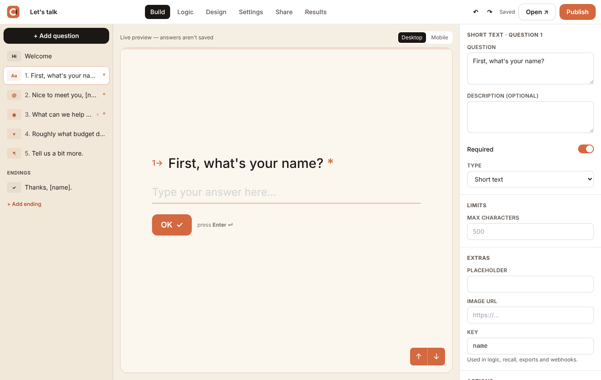
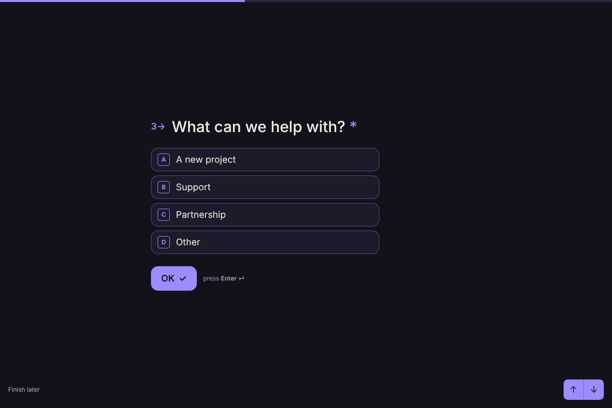
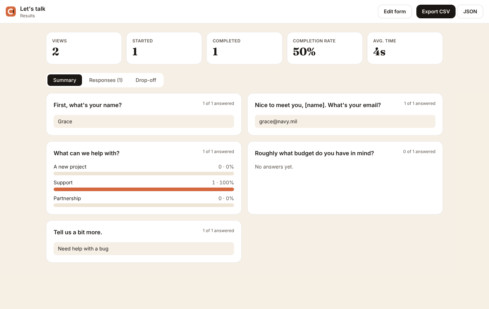

<p align="center">
  
</p>

<p align="center"><b>Forms people actually finish. Free forever.</b><br>
A beautiful, conversational, open-source form builder you host yourself.<br>
No response limits. No paywalled features. No monthly bill.</p>

<p align="center">
  
</p>

---

## Why Clayform exists

One-question-at-a-time forms get more people to the end. The tools that made them popular charge for it, and their reviews keep raising the same complaints:

| What reviewers complain about | What Clayform does |
| --- | --- |
| Prices go up fast once you need more responses | **$0.** MIT licensed. Run it on a $5 server, a Raspberry Pi or your laptop. |
| Small monthly response caps that stop a form mid-campaign | **No caps.** Your server, your SQLite file. Set a limit only if *you* want one. |
| Useful features (logic, branding removal, partial responses) locked to higher tiers | **Everything unlocked**: logic, scoring, hidden fields, file uploads, webhooks, custom endings, no badge. |
| Thin reporting | **Drop-off per question**, NPS calculated, completion rate, average time, endings reached. |
| Buggy or clumsy CSV exports | **Clean CSV** (Excel-safe UTF-8, protected against formula injection), JSON export, signed webhooks. |
| Respondents lose everything if they close the tab | **Save & resume**: answers save as people go; they can pick up later or copy a link to finish on another device. |
| Spotty connections lose submissions | **Offline-safe**: if the network drops, answers wait on the device and send when it's back. |
| No bulk editing | **Bulk-paste options**, duplicate questions, **undo/redo** across the whole builder. |
| Locked into one vendor | **Forms as code**: every form is plain JSON you can back up, diff in Git and import anywhere. |

<p align="center">
  
  
</p>

## Features

- **18 question types**: short text, long text, email, phone, number, website, multiple choice (single/multi, “Other”, shuffle), picture choice, dropdown (searchable), yes/no, ranking (drag or arrows), star rating, opinion scale, NPS, date, file upload, consent and statement.
- **Two layouts**: one question at a time, or a classic one-page form. Same logic engine either way.
- **Logic jumps** that read like English: *if* an answer, hidden field or score *is / contains / is at least …* *then* go to a question or a specific ending. AND/OR conditions.
- **Scoring** for quizzes and lead scoring, with **endings chosen by score range**.
- **Answer recall**: `Thanks {{name}}!`, `You scored {{score}}`, plus hidden fields from the URL (`?source=newsletter`).
- **Keyboard first**: Enter to continue, A/B/C to pick options, Y/N, number keys for scales, ⌥↑/⌥↓ to move.
- **Themes**: 8 presets plus your own colours, fonts, corner radius, background images. The designer warns you about low contrast.
- **Live builder preview** on desktop and mobile widths, with autosave and undo.
- **Embeds**: inline, popup or plain iframe from one script tag, with hidden fields and a `clayform:submit` event.
- **Results**: summaries per question, a searchable response table, partial responses, response detail, bulk delete.
- **Webhooks** on every completed response, optionally signed with HMAC-SHA256.
- **Schedule & limits**: close on a date, after N responses, or by hand.
- **Accessible**: real labels and roles, focus management, visible errors announced to screen readers, Reduce Motion respected.
- **Private**: no third-party trackers. Uploaded files can only be downloaded from the dashboard.

## Quick start

Requires **Node.js 22.13+** (Clayform uses Node's built-in SQLite, so there's no database to install).

```bash
git clone https://github.com/claycovyn/clayform
cd clayform
npm install
npm run dev
```

Open http://localhost:3000 and click **Open dashboard**. In development the dashboard is open without a password.

### Run it for real

```bash
cp .env.example .env.local     # set CLAYFORM_PASSWORD and CLAYFORM_SECRET
npm run build
npm start
```

### Docker

```bash
CLAYFORM_PASSWORD=choose-something-long docker compose up -d
```

Data (the SQLite database and uploaded files) lives in the `clayform-data` volume. Back it up by copying `/data`.

## Configuration

| Variable | Default | What it does |
| --- | --- | --- |
| `CLAYFORM_PASSWORD` | — | Dashboard password. **Required in production**; without it the dashboard stays locked. |
| `CLAYFORM_SECRET` | password | Signs the session cookie. Use `openssl rand -hex 32`. |
| `CLAYFORM_DATA_DIR` | `./data` | Where `clayform.db` and `uploads/` live. |
| `NEXT_PUBLIC_SITE_URL` | request origin | Public URL used in share links and embed code. |
| `CLAYFORM_MAX_UPLOAD_MB` | `10` | Max size for file-upload answers. |

## Embedding

```html
<!-- Inline -->
<div data-clayform="your-form-slug" style="height:560px"></div>
<!-- Popup -->
<button data-clayform-popup="your-form-slug" data-clayform-hidden="plan=pro">Get started</button>

<script src="https://forms.example.com/embed.js" async></script>
<script>
  window.addEventListener("message", (e) => {
    if (e.data?.type === "clayform:submit") console.log("Submitted", e.data.responseId);
  });
</script>
```

## Webhooks

Each completed response is `POST`ed as JSON:

```json
{
  "event": "response.completed",
  "form": { "id": "…", "slug": "…", "title": "Let's talk" },
  "response": {
    "id": "…", "startedAt": "…", "completedAt": "…", "score": 0, "ending": "Thanks!",
    "hidden": { "source": "newsletter" },
    "answers": [{ "ref": "email", "type": "email", "question": "What's your email?", "value": "ada@example.com" }]
  }
}
```

With a signing secret set, verify the `X-Clayform-Signature` header:

```js
const expected = "sha256=" + crypto.createHmac("sha256", SECRET).update(rawBody).digest("hex");
```

## Forms as code

Download any form as JSON from **Share → Download form JSON**, and import it with **Import JSON** on the dashboard. The schema is validated on import ([`src/lib/schema.ts`](src/lib/schema.ts)), so a hand-edited file can't break an install.

## How it's built

- **Next.js 15** (App Router) + **React 19** + **Tailwind CSS**, TypeScript throughout.
- **One engine, two sides**: [`src/lib/engine.ts`](src/lib/engine.ts) holds logic, scoring, recall and validation as pure functions. The player runs it in the browser; the API runs it again on the server, so a tampered request can't skip a required question, pick an option that doesn't exist or land on the wrong ending.
- **Storage**: `node:sqlite` with WAL mode; forms and responses stored as JSON documents.
- **No tracking, no external services.** Fonts load from Google Fonts; remove the `<link>` in `src/app/layout.tsx` to self-host them.

```
src/
  lib/engine.ts        logic jumps, scoring, recall, validation (shared)
  lib/submit.ts        partial saves, resume tokens, completion, webhooks
  lib/db.ts            SQLite storage
  components/player/   the form respondents see
  components/builder/  build, logic, design, settings, share
  components/results/  summary, responses, drop-off
  app/api/             JSON API
public/embed.js        the embed script
```

## Development

```bash
npm run dev         # local server with hot reload
npm test            # engine unit tests (vitest)
npm run typecheck
npm run build
```

## Roadmap

Ideas we'd love help with: multiple users and workspaces, email notifications, Postgres adapter, payment questions (Stripe), signature and address questions, translations, A/B testing of question wording, a visual logic map, Google Sheets sync.

## Contributing

PRs welcome — see [CONTRIBUTING.md](CONTRIBUTING.md).

## License

[MIT](LICENSE). Clayform is an independent project, written from scratch. It is not affiliated with, endorsed by or derived from the code of any other form product. Product names mentioned anywhere belong to their owners.
